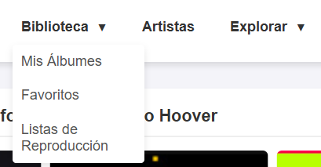
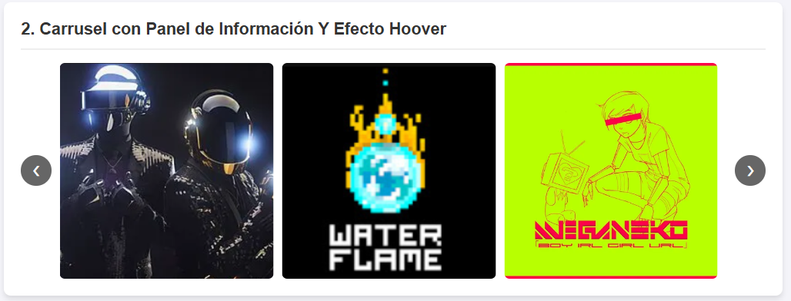
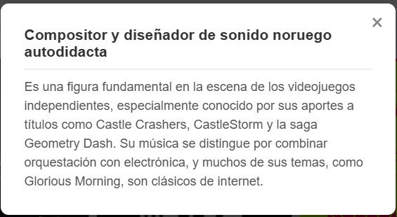

# Librería de Componentes Visuales

**Autor:** Roque Antonio Cruz Santiago

**Repositorio:** https://github.com/Lordynt/Actividad3

**Demo en vivo:** https://lordynt.github.io/Actividad3/

Conjunto de componentes visuales reutilizables hechos con HTML, CSS y JavaScript puro (sin frameworks). Resuelve el problema de tener que reescribir desde cero elementos comunes de interfaz web: menús de navegación con submenús, carruseles de imágenes con panel informativo y efectos hover.

Pensada para integrarse en cualquier proyecto web copiando y pegando el bloque de HTML del componente que necesites, más los estilos y scripts correspondientes.

---

## Componentes incluidos

| # | Componente | Descripción | Requiere JS |
|---|---|---|---|
| 1 | Menú Dropdown | Menú de navegación con submenús desplegables al pasar el mouse | No (solo CSS) |
| 2 | Carrusel con panel de información | Galería de imágenes navegable + panel emergente con información al hacer clic | Sí |

---

## Instalación

Agregá el archivo CSS en el `<head>` de tu HTML y el archivo JS antes de cerrar el `</body>`:

```html
<!DOCTYPE html>
<html lang="es">
<head>
  <meta charset="UTF-8">
  <meta name="viewport" content="width=device-width, initial-scale=1.0">
  <title>Mi proyecto</title>
  <link rel="stylesheet" href="css/componente.css">
</head>
<body>

  <!-- Aquí va el HTML de los componentes que quieras usar -->

  <script src="js/componente.js"></script>
</body>
</html>
```

> Asegurate de que las rutas `css/componente.css` y `js/componente.js` coincidan con la ubicación real de los archivos en tu proyecto.

---

## Uso

### Componente 1 — Menú Dropdown

Menú de navegación con submenús que se despliegan al pasar el mouse. **No requiere JavaScript** — funciona puramente con CSS usando la pseudo-clase `:hover`.

```html
<nav class="nav-dropdown">
  <ul class="menu">
    <!-- Item con submenú -->
    <li class="menu-item has-dropdown">
      <a href="#" class="menu-link">Biblioteca <span class="arrow">▼</span></a>
      <ul class="dropdown">
        <li><a href="#">Mis Álbumes</a></li>
        <li><a href="#">Favoritos</a></li>
        <li><a href="#">Listas de Reproducción</a></li>
      </ul>
    </li>

    <!-- Item sin submenú -->
    <li class="menu-item">
      <a href="#" class="menu-link">Artistas</a>
    </li>

    <!-- Otro item con submenú -->
    <li class="menu-item has-dropdown">
      <a href="#" class="menu-link">Explorar <span class="arrow">▼</span></a>
      <ul class="dropdown">
        <li><a href="#">Géneros</a></li>
        <li><a href="#">Décadas</a></li>
        <li><a href="#">Nuevos Lanzamientos</a></li>
      </ul>
    </li>
  </ul>
</nav>
```

**Cómo personalizarlo:**
- Cambiá los textos de cada `<a>` por los que necesites.
- Agregá más `<li class="menu-item has-dropdown">` para más opciones con submenú.
- Agregá más `<li class="menu-item">` para opciones simples.

---

### Componente 2 — Carrusel con Panel de Información

Carrusel de imágenes configurable desde el HTML. Al hacer clic en cualquier imagen, se abre un panel emergente con la información definida en el atributo `data-info`.

#### HTML del carrusel

```html
<div class="carrusel-contenedor" id="miCarrusel" data-visible="3">
  <button class="btn-carrusel prev">❮</button>

  <div class="carrusel-viewport">
    <div class="carrusel-track">
      

      

      
    </div>
  </div>

  <button class="btn-carrusel next">❯</button>
</div>
```

#### HTML del panel de información

```html
<div id="panelInfo" class="panel-info oculto">
  <div class="panel-contenido">
    <span class="panel-cerrar" id="btnCerrarPanel">&times;</span>
    <h3 id="panelTitulo">Información</h3>
    <p id="panelTexto">Aquí va el texto.</p>
  </div>
</div>
```

#### Configuración

| Atributo | Dónde se usa | Qué hace |
|---|---|---|
| `data-visible="3"` | En el contenedor del carrusel | Define cuántas imágenes se muestran a la vez |
| `data-info="..."` | En cada `` | Texto que aparece en el panel al hacer clic |
| `alt="..."` | En cada `` | Se usa como título del panel |

**Ejemplo para mostrar 4 imágenes a la vez:**

```html
<div class="carrusel-contenedor" id="miCarrusel" data-visible="4">
  ...
</div>
```

No es necesario modificar el JavaScript para cambiar la cantidad de imágenes visibles.

---

## Cómo funciona el JavaScript

La lógica está encapsulada en una **clase `Carrusel`** que se inicializa automáticamente al cargar la página.

### Inicialización

```javascript
document.addEventListener('DOMContentLoaded', () => {
  const miCarrusel = new Carrusel('miCarrusel');
});
```

El constructor recibe el **ID del contenedor** del carrusel. El resto de la configuración se lee desde el HTML.

### Métodos principales

| Método | Qué hace |
|---|---|
| `init()` | Registra los eventos de navegación y del panel |
| `ajustarTamaño()` | Calcula el ancho de cada imagen según `data-visible` |
| `actualizarVista()` | Desplaza el track para mostrar el índice actual |
| `siguiente()` | Avanza una posición hacia la derecha |
| `anterior()` | Retrocede una posición hacia la izquierda |

### Ejemplo: abrir el panel con información de la imagen

```javascript
this.imagenes.forEach((img, index) => {
  img.addEventListener('click', () => {
    const textoInfo = img.dataset.info || 'Sin información disponible.';
    const altText = img.alt || 'Imagen ' + (index + 1);

    this.panelTitulo.textContent = altText;
    this.panelTexto.textContent = textoInfo;

    this.panel.classList.remove('oculto');
  });
});
```

### Ejemplo: navegación del carrusel

```javascript
siguiente() {
  const maxIndex = this.totalImagenes - this.visibles;
  if (this.index < maxIndex) {
    this.index++;
    this.actualizarVista();
  }
}

anterior() {
  if (this.index > 0) {
    this.index--;
    this.actualizarVista();
  }
}
```

---

## Capturas de pantalla

### Menú Dropdown desplegado



### Carrusel con imágenes visibles



### Panel de información abierto



---

## Estructura del proyecto

```
/Actividad3
├── index.html          -> Página con los componentes
├── README.md
├── /css
│   └── componente.css  -> Estilos de los componentes
├── /js
│   └── componente.js   -> Lógica del carrusel y del panel
└── /img
    ├── shirobon.png
    ├── deadmau5.png
    ├── daft punk.png
    ├── waterflame.png
    └── meganeko.png
```

---

## Tecnologías usadas

- **HTML5** — Estructura de los componentes.
- **CSS3** — Estilos, transiciones, efectos hover, layout con Flexbox.
- **JavaScript (ES6)** — Clase `Carrusel`, manejo del DOM y eventos.

---

## Licencia

Uso libre para fines educativos.